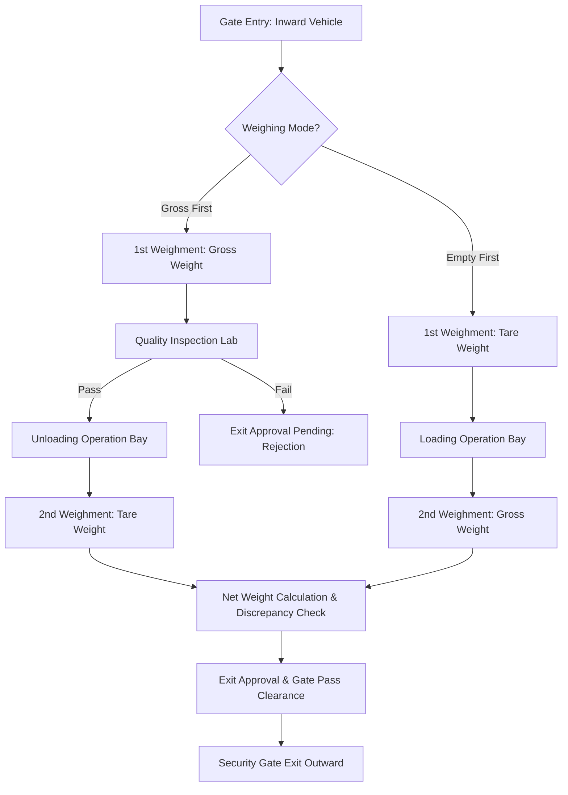

<div align="center">

# 🚛 WeighBridge Pro — Industrial Weighment & Logistics Backend API
### Enterprise Weighbridge Management, Multi-Stage Vehicle Tracking & Weight Ledger System

[](https://laravel.com)
[](https://php.net)
[](https://mysql.com)
[](https://laravel.com/docs/sanctum)
[](LICENSE)

**Live Production Server:** [http://weight.shrieelaxmi.in](http://weight.shrieelaxmi.in)  
**API Endpoint:** [http://weight.shrieelaxmi.in/api/v1](http://weight.shrieelaxmi.in/api/v1)

</div>

---

## 📋 Table of Contents
- [Overview](#-overview)
- [Key Features](#-key-features)
- [System Architecture & Workflow](#-system-architecture--workflow)
- [Tech Stack](#-tech-stack)
- [Quick Start & Local Setup](#-quick-start--local-setup)
- [API Reference](#-api-reference)
- [Database Seeders & Demo Accounts](#-database-seeders--demo-accounts)
- [Production Server Deployment](#-production-server-deployment)
- [Security & Compliance](#-security--compliance)

---

## 🌟 Overview

**WeighBridge Pro Backend** is a high-reliability industrial backend API engineered for manufacturing plants, mills, logistics hubs, and weighbridge weigh-stations. It automates and enforces strict verification across the entire vehicle lifecycle: from security gate entry, initial gross/tare weighing, laboratory quality testing, loading/unloading bays, second weighment, weight discrepancy verification, to final security exit approval.

---

## ⚡ Key Features

- 🚪 **Security Gate Entry & Duplicate Detection:** Real-time license plate duplicate verification preventing unlogged re-entries.
- ⚖️ **Dual Weighment Protocol:** Handles Gross Weight (1st/2nd weighment) and Tare Weight (Empty Weight) with automatic net weight calculation in Metric Tonnes (MT) and Kilograms (KG).
- 🔬 **Quality Inspection Specs:** Parameter-based tolerance validation (Moisture %, Purity %, Foreign Matter) with instant PASS/REJECT determination.
- 📦 **Yard & Material Bay Logistics:** Assigns bays, loading/unloading operations, and inventory movement tracking.
- 🛡️ **Role-Based Access Control (RBAC):** Granular permission gates for Super Admin, Gate Security, Weighbridge Operators, QA Chemists, and Exit Clearance.
- 🖨️ **Official A4 PDF Printables:** Blade templates rendered with print stylesheets for:
  - Official Weighment Slips (`/reports/movement/{id}/slip?print=1`)
  - Bulk Entry Registers (`/reports/bulk-register?date_from=...&date_to=...&print=1`)
- 📜 **Full Audit Logging:** Immutable trail recording IP address, timestamp, old vs new JSON values for every operational transaction.

---

## 🔄 System Architecture & Workflow



---

## 💻 Tech Stack

- **Framework:** Laravel 11.x (Clean Architecture, Service Layer & Presenters)
- **Language:** PHP 8.2+
- **Database:** MySQL 8.0+ / MariaDB
- **Authentication:** Laravel Sanctum Bearer Token Auth
- **Reporting Engine:** Laravel Blade with CSS3 Print Paged Media (`@page { size: A4 portrait }`)
- **API Format:** JSON RESTful with standardized API Response envelopes

---

## 🚀 Quick Start & Local Setup

### Prerequisites
- PHP >= 8.2 with `bcmath`, `ctype`, `fileinfo`, `mbstring`, `openssl`, `pdo_mysql`, `tokenizer`, `xml`
- Composer 2.x
- MySQL 8.0+ / MariaDB

### Installation Steps

1. **Clone the Repository:**
   ```bash
   git clone https://github.com/dineshmahidev/weightbridg-back.git
   cd weightbridg-back
   ```

2. **Install PHP Dependencies:**
   ```bash
   composer install --optimize-autoloader
   ```

3. **Configure Environment:**
   ```bash
   cp .env.example .env
   php artisan key:generate
   ```

4. **Setup Database:**
   Update `.env` with your MySQL credentials:
   ```env
   DB_CONNECTION=mysql
   DB_HOST=127.0.0.1
   DB_PORT=3306
   DB_DATABASE=weight_machine
   DB_USERNAME=root
   DB_PASSWORD=
   ```

5. **Run Migrations & Seed Sample Data:**
   ```bash
   php artisan migrate:fresh --seed
   ```

6. **Create Storage Symlink:**
   ```bash
   php artisan storage:link
   ```

7. **Start Local Development Server:**
   ```bash
   php artisan serve --port=8000
   ```
   Backend will be accessible at: `http://localhost:8000/api/v1`

---

## 📡 API Reference

Base URL: `/api/v1`

### Authentication
| Method | Endpoint | Description |
|---|---|---|
| `POST` | `/login` | User login (returns Bearer token & permissions) |
| `POST` | `/logout` | Revoke current user session |
| `GET` | `/me` | Get authenticated user profile & active role |

### Vehicle Movements
| Method | Endpoint | Description |
|---|---|---|
| `GET` | `/movements` | List paginated movements with status & date filters |
| `POST` | `/movements` | Register initial gate entry (Inward vehicle) |
| `GET` | `/movements/{id}` | Complete vehicle movement details & history |
| `GET` | `/movements/duplicate-check` | Real-time license plate duplicate inspection |

### Weighbridge Operations
| Method | Endpoint | Description |
|---|---|---|
| `POST` | `/movements/{id}/first-weighment` | Record 1st weight (Gross / Tare) |
| `POST` | `/movements/{id}/second-weighment` | Record 2nd weight & compute Net Weight |
| `POST` | `/movements/{id}/weight-verification` | Verify discrepancy & authorize tolerance |

### Quality & Yard Operations
| Method | Endpoint | Description |
|---|---|---|
| `POST` | `/movements/{id}/quality-inspection` | Record QA parameters and pass/fail verdict |
| `POST` | `/movements/{id}/material-operation` | Record loading/unloading bay completion |
| `POST` | `/movements/{id}/exit-approval` | Approve vehicle exit pass |
| `POST` | `/movements/{id}/gate-exit` | Record final outward vehicle exit |

### Reports & A4 Printing
| Method | Endpoint | Description |
|---|---|---|
| `GET` | `/reports/date-wise` | Summary analytics by date range |
| `GET` | `/reports/movement/{id}/slip` | Official Weighment Slip Blade Preview |
| `GET` | `/reports/bulk-register` | Official Bulk Entry Register Blade Preview |

---

## 👥 Database Seeders & Demo Accounts

Default password for all demo accounts: `password`

| Role | Email | Permissions |
|---|---|---|
| **Super Admin** | `superadmin@weighbridge.local` | Full system governance, all plants |
| **Plant Manager** | `admin@plant.local` | Company management, user config, approvals |
| **Weighbridge Operator**| `weighbridge@plant.local` | Scale 1 & 2 weight capture, slips |
| **Quality Officer** | `quality@plant.local` | QA parameter grading & lab verdicts |
| **Gate Security** | `gate@plant.local` | Inward registration, license plate check |
| **Exit Security** | `exit@plant.local` | Exit approval checks, gate pass clearance |

---

## 🌐 Production Server Deployment

### Server Details:
- **Production Host:** `http://weight.shrieelaxmi.in`
- **Document Root:** `/public` folder of this Laravel project

### Apache VirtualHost Configuration
```apache
<VirtualHost *:80>
    ServerName weight.shrieelaxmi.in
    DocumentRoot /var/www/weightbridg-back/public

    <Directory /var/www/weightbridg-back/public>
        AllowOverride All
        Require all granted
    </Directory>

    ErrorLog ${APACHE_LOG_DIR}/weight_error.log
    CustomLog ${APACHE_LOG_DIR}/weight_access.log combined
</VirtualHost>
```

### Production Permissions
```bash
sudo chown -R www-data:www-data /var/www/weightbridg-back/storage /var/www/weightbridg-back/bootstrap/cache
sudo chmod -R 775 /var/www/weightbridg-back/storage /var/www/weightbridg-back/bootstrap/cache
```

---

## 📄 License
This project is proprietary software developed for WeighBridge Management Operations. All rights reserved.
